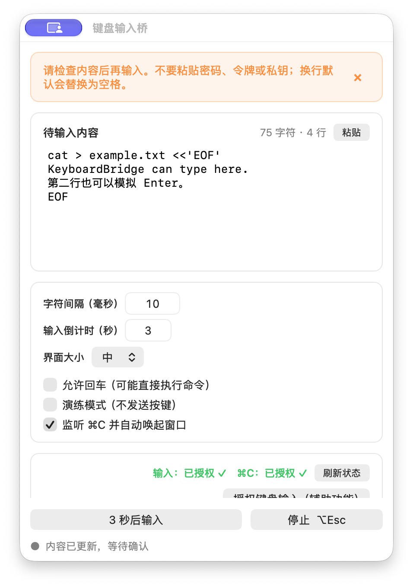
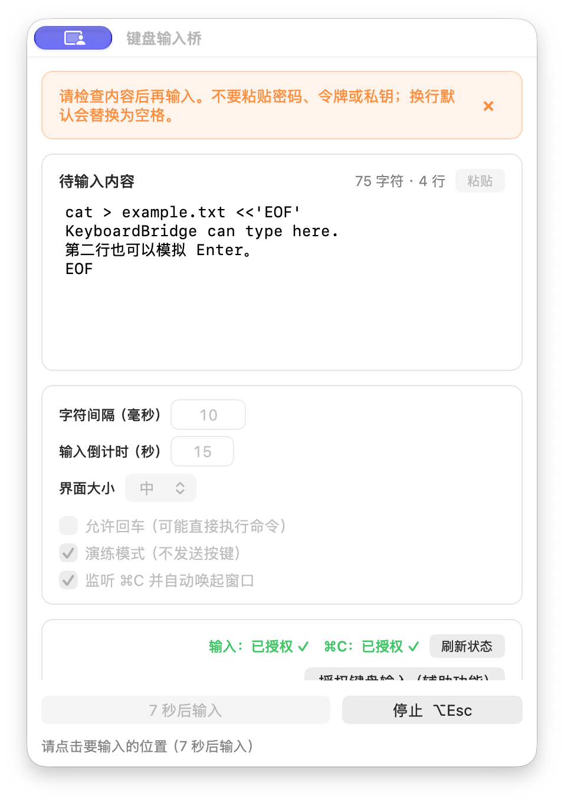

# 键盘输入桥（Windows / macOS）

KeyboardBridge 是一个本地、可见、需要人工确认的“文本转键盘输入”工具。它并不只面向云桌面：只要目标文本框或界面允许正常键盘输入，即使禁用了剪贴板粘贴，也可以尝试用 KeyboardBridge 逐字符输入。

复制或手动填入文本后，工具会显示置顶、可编辑的预览；点击倒计时输入，再把焦点点到目标位置，KeyboardBridge 会像实体键盘一样发送字符。它不读取目标应用内部数据，也不注入进程或修改安全策略。

## 下载

请从 [GitHub Releases](https://github.com/KingInLoop/KeyboardBridge/releases/latest) 下载开箱即用的成品：

- macOS：`KeyboardBridge-macOS-v0.2.10.pkg`，支持 Apple Silicon 与 Intel。
- Windows：推荐 `KeyboardBridge-Windows-WinForms-x64-v0.2.5.zip`，解压后直接运行单文件 EXE。
- Windows 备选：`KeyboardBridge-Windows-Tauri-x64-v0.2.5.zip`，需保持 EXE 与 `WebView2Loader.dll` 在同一目录。

当前平台版本：macOS v0.2.10，Windows v0.2.5。

## 适用场景

- 禁止粘贴、但仍允许键盘输入的网页表单和文本框。
- 企业办公系统、旧式桌面软件和嵌入式 WebView 输入界面。
- 远程桌面、云电脑、虚拟机控制台、VNC/RDP 窗口。
- Web Shell、远程终端、设备管理后台和实验环境控制台。
- 需要将较长文本按真实按键节奏输入的其他普通界面。

目标程序仍可以主动拒绝模拟输入。密码框、验证码、安全键盘、游戏和受保护窗口通常具有额外限制，本项目不会尝试绕过这些机制。

## 界面与操作示例

下面以 macOS 界面为例，Windows 版的操作流程相同。

### 1. 粘贴或载入内容并检查

可以开启复制监听，也可以直接点击待输入区按 `Command+V` / `Ctrl+V`，或使用“粘贴”按钮。发送前可修改文本、字符间隔、倒计时和回车策略。

<p align="center">
  
</p>

### 2. 点击输入并选择目标位置

点击“几秒后输入”后，在倒计时结束前点中目标文本框。窗口不会抢回输入焦点；需要终止时，可按 macOS 的 `Option+Esc` 或 Windows 的 `Ctrl+Alt+Esc`。

<p align="center">
  
</p>

第一次使用建议勾选“演练模式”：它会完整走一遍倒计时和字符处理，但不会真正发送按键。

## 安全边界

- 工具不注入目标应用进程、不修改策略、不隐藏运行状态，也不尝试获取管理员权限。
- 默认**不输入换行**，避免命令被意外执行。只有勾选“允许回车”后，换行才会变成 Enter。
- 默认日志只记录时间、平台、字符数、耗时、结果和内容哈希前 12 位，**不记录剪贴板正文**。
- 不要用它输入密码、令牌、私钥或其他秘密。输入内容对目标应用而言等同于真实键盘输入。
- 使用前请确认目标系统和所在单位允许键盘自动化。某些应用、安全软件或受保护控件会主动拦截模拟输入。

## 快速使用

### macOS

1. 双击 `KeyboardBridge-macOS-v0.2.10.pkg`，按安装器提示完成安装。应用会固定安装到 `/Applications/KeyboardBridge.app`；再次安装时会识别并覆盖旧版，并清理经校验的 `~/Applications` 旧副本。
2. 安装完成后应用会自动启动。先点击“授权键盘输入（辅助功能）”，在系统设置中允许 KeyboardBridge。
3. 再点击“授权复制监听（输入监控）”，在系统设置中允许 KeyboardBridge。两项权限用途不同，需要分别完成；按钮点击后会自动复查状态。
4. 开启“监听 ⌘C 并自动唤起窗口”后，按 `Command+C` 复制文字、表单内容或命令，置顶窗口会立即出现并显示可编辑预览；重复复制相同内容也会触发。
5. 根据需要设置 1–30 秒输入倒计时和小/中/大界面档位，再点击“几秒后输入”，立刻点到要输入的位置。
6. 如需紧急停止，按 `Option + Esc`。

无论“监听 ⌘C”开启还是关闭，都可以点击待输入区后直接按 `Command+V`，也可以点击标题右侧的“粘贴”按钮。监听开关只控制复制后的自动载入和自动唤起，不影响手动粘贴、手动编辑或发送。

应用会同时显示在 Dock 和顶部菜单栏。窗口最小化后可从 Dock 恢复；关闭窗口后可从顶部菜单栏的键盘图标恢复。

第一次打开未签名的本地测试安装包时，可能需要在 Finder 中右键安装包并选择“打开”。正式分发应使用 Developer ID 对应用和安装包签名并完成 Apple 公证。

macOS 会分别检查“发送键盘输入”和“监听 Command+C”所需的系统权限。系统安全机制不允许应用自行批准权限，因此界面提供两个用途明确的授权按钮；每个按钮会打开对应设置页并定时复查结果。

如果系统设置中的开关已经打开，但工具仍显示未授权，先点击权限状态旁的“刷新状态”。只有刷新后仍未授权时，界面才会展开“清理旧授权记录并重新授权”；它只会重置 KeyboardBridge 的辅助功能和输入监控记录，授权成功后会自动收起。临时签名测试包在升级时会由安装器自动执行这项清理，避免旧签名条目看似开启、实际并不属于当前版本。

平时不需要自动载入时，可以关闭“监听 ⌘C 并自动唤起窗口”。关闭后应用会停止复制快捷键监听，不读取剪贴板，也不会因普通复制操作自动出现；开关状态会在下次启动时保留。手动 `Command+V` 和“粘贴”按钮仍然可用。

### Windows

1. 解压下载包并启动 `KeyboardBridge-WinForms.exe`；Tauri 版则运行 `KeyboardBridge-Tauri.exe`。
2. 开启“监听 Ctrl+C 并自动唤起窗口”后，按 `Ctrl+C` 复制文字、表单内容或命令，窗口会立即显示；重复复制相同内容也会触发。
3. 根据需要设置输入倒计时和界面档位，点击“几秒后输入”，再点击要输入的位置。
4. 如需紧急停止，按 `Ctrl + Alt + Esc`。

Windows 版是普通用户程序，不需要管理员权限。目标程序若以管理员身份运行，Windows 的完整性级别规则可能阻止普通权限程序向其发送输入；不要为此提升权限，保持两边权限级别一致即可。

平时不需要自动载入时，可以关闭“监听 Ctrl+C 并自动唤起窗口”。关闭后程序会卸载复制快捷键钩子，不读取剪贴板，也不会自动出现；开关状态会在下次启动时保留。仍可从任务栏或系统托盘恢复窗口并手动粘贴内容。

## 诊断与测试

- “演练模式”只模拟计时和逐字符处理，不真正发送按键，适合先验证内容长度、速度和停止功能。
- 安全提示每次启动显示，5 秒后可关闭；关闭只释放界面空间，不改变安全策略。
- 小、中、大三档界面缩放为 80%、100%、125%，缩放选择和复制监听开关都会持久保存。
- 启动参数 `--self-test` 运行内置自检并返回退出码。
- macOS 日志：`~/Library/Logs/KeyboardBridge/bridge-YYYYMMDD.log`
- Windows 日志：`%LOCALAPPDATA%\KeyboardBridge\logs\bridge-YYYYMMDD.log`
- 每个版本的构建脚本都会运行自检。

建议前几轮迭代都保留“演练模式”和脱敏日志；确认稳定后也没有必要删除，它们不包含命令正文。

## 从源码构建

### macOS（macOS 13+）

```bash
cd macos
./build-macos-installer.sh
```

产物在 `macos/dist/KeyboardBridge-macOS-v0.2.10.pkg`，安装目标为 `/Applications/KeyboardBridge.app`。安装前脚本只会在 bundle id 确认为 `local.keyboardbridge.app` 后替换旧版本；安装完成后会注册并自动启动新版本。若构建使用临时签名，安装器会重置该 bundle id 的旧辅助功能与输入监控记录；Developer ID 签名升级会保留已有授权。

构建脚本会自动寻找本机的 `Developer ID Application` 证书；没有证书时回退为仅供本机测试的临时签名。也可以明确指定签名身份，并在配置公证凭据后自动提交公证：

```bash
KEYBOARD_BRIDGE_SIGN_IDENTITY="Developer ID Application: Your Name (TEAMID)" \
KEYBOARD_BRIDGE_INSTALLER_IDENTITY="Developer ID Installer: Your Name (TEAMID)" \
KEYBOARD_BRIDGE_NOTARY_PROFILE="keyboardbridge-notary" \
./build-macos-installer.sh
```

### Windows（Windows 10/11 x64）

需要 .NET 8 SDK：

```powershell
cd windows\winforms
.\build-windows.ps1
```

产物为 self-contained 单文件程序。Windows 还提供 Tauri 2 实现，源码位于 `windows\tauri`；详见 [Windows 开发说明](windows/README.md)。

## 源码结构

- `macos/`：Swift/AppKit universal 应用、安装器脚本和权限处理。
- `windows/winforms/`：.NET 8 WinForms 单文件实现。
- `windows/tauri/`：Tauri 2、Rust 与原生 Web 前端实现。
- `windows/assets/`：Windows 图标素材。
- `QA-CHECKLIST.md`：跨平台手工验证清单。

## 已知限制

- 键盘布局、输入法、目标应用和终端快捷键都可能影响结果。开始时建议 8–15 ms/字符；丢字符时调慢。
- macOS 和 Windows 对 ASCII 命令都使用真实物理键码/扫描码，对无法映射的非 ASCII 字符使用 Unicode 回退。
- 多行文本默认把换行替换为空格；启用“允许回车”后会逐行执行，使用前务必检查预览。

